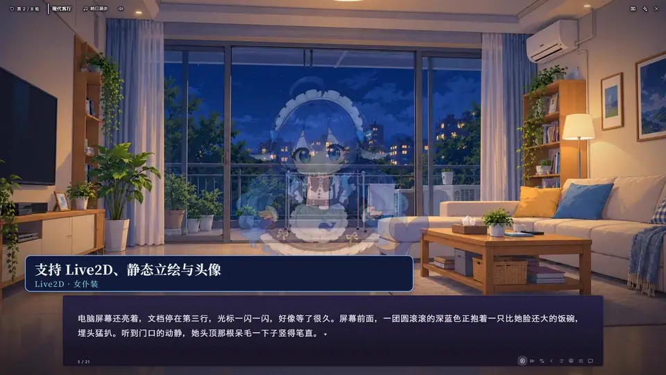
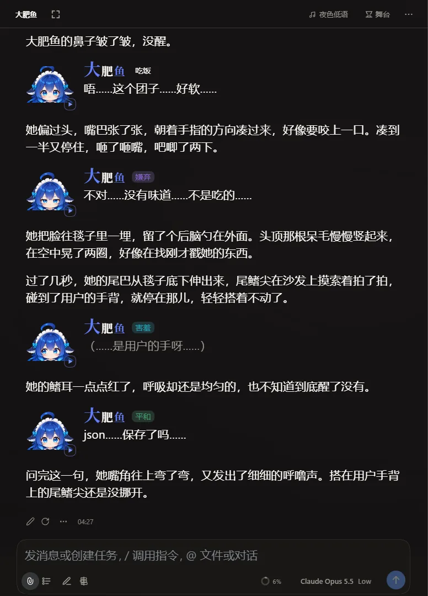
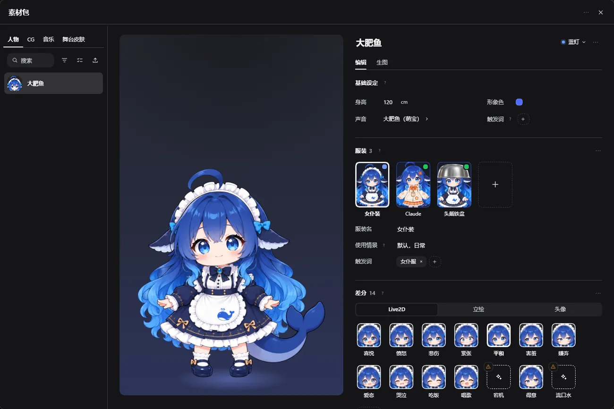

# DSH Tavern Galgame（alpha r12）

> 本项目通过设置一个后台「导演AI」来在dsh-tavern中实现近似galgame的演出效果。

**DSH Tavern Galgame** 是 [DSH Tavern](https://github.com/flizzywine/dsh-tavern) 的一个 fork，由 kousakayou 维护。

项目地址：<https://github.com/jerryzmtz/dsh-tavern-galgame>

上游 DSH Tavern 负责角色扮演：人物卡、世界书、变量和对话。本 fork 保留这些功能，另外加入一个**后台导演AI**。前台的角色扮演模型照常写故事；导演AI在后台读每条回复，再通过结构化的工具调用切换背景、音乐、环境音、立绘、差分、镜头、灯光、语音和模组演出。导演AI只读剧情，不改写正文、变量或提示词，所以聊天视图和舞台视图显示的是同一份回复。

当前是 **公开 alpha r12**，功能还在变，也有已知问题，详见下文「alpha 状态与已知限制」。

r12 新增舞台设置向导 v3、统一生图界面、Live2D / Spine 模型导入、生图提示词面板与模组架构基础，并改进素材去重、缩略图、舞台动作和上下文保留。Spine 专有运行时不随公开版分发，缺少运行时时使用静态表现或隐藏；使用运行时需自行满足其许可要求。大肥鱼示例卡包包含封面，可直接导入，无需先导入 PNG。

本项目是 DSH Tavern 的个人改版，当前同步到上游 2.6.0。每轮自动生图默认关闭，需要自行配置并开启后才会调用生图服务。

[](https://github.com/jerryzmtz/dsh-tavern-galgame/releases/download/alpha-r12/dsh-tavern-galgame-promo-v4.4-1080p.mp4)

[▶ 观看宣传片（50 秒）](https://github.com/jerryzmtz/dsh-tavern-galgame/releases/download/alpha-r12/dsh-tavern-galgame-promo-v4.4-1080p.mp4)

| 聊天视图：同一轮回复的正文与台词 | 舞台素材：大肥鱼的服装与差分 |
| --- | --- |
|  |  |

截图来自大肥鱼示例卡的一局游玩。

## 宣传片

边聊天边看 AI 把故事演成 Galgame：[观看宣传片 v4.4（1080p，50.2 秒）](https://github.com/jerryzmtz/dsh-tavern-galgame/releases/download/alpha-r12/dsh-tavern-galgame-promo-v4.4-1080p.mp4)。

音乐、美术及其他素材的完整署名与许可见 [alpha-r12 发行说明](https://github.com/jerryzmtz/dsh-tavern-galgame/releases/tag/alpha-r12)中的「Credits / 署名与许可」。

## 功能

- **galgame 舞台**：背景、文本框逐页阅读、履历回看、自动阅读（可调速度）、只跳已读的快进。
- **立绘与差分**：分层静态立绘或 Live2D；每个人物可以有多套服装和多个情绪差分，导演按台词换差分。也支持只有一张图、没有差分的人物。
- **声音**：BGM、音效、环境音分开选择；环境音可以和 BGM、语音同时播放。
- **镜头与光影**：场景、天气、灯光、镜头、景深等持续状态由导演增量控制；白天 / 黄昏 / 夜晚使用全局时段，不再依赖素材包里的时段滤镜。
- **语音（可选）**：按台词逐句配音，翻到哪句播哪句。需要自己配置语音服务（如 Azure、Qwen、火山引擎、GPT-SoVITS、Fish 或 OpenAI 兼容接口），也可以完全不开。另有全局读音词典。
- **模组演出**（全新安装默认关闭，按需打开全局开关）：
  - **物品**：使用可用的物品条目（props）在舞台上展示物品图；附带通用物品包，导入方式见下文；
  - **手机**：把正文里的短信、聊天呈现在手机界面里，可设置机框、壁纸和提示音；内置手机无需旧手机素材包，壁纸在模组设置中上传；
  - **文字演出**：标题、连词、倒数、关系图、对照、揭示、重复、档案等文字卡模板，强度分「克制 / 标准 / 浓烈」三档；
  - **演出**：使用可用的演出条目，为舞台添加持续演出效果；
  - **弹幕**：可选的模拟观众飘屏与直播聊天，默认关闭，只观看、不影响剧情；生成评论使用你自己配置的模型调用，可能产生额外费用。
- **模组设置**：模组的开关只有全局一处，打开后所有卡都能用；各卡的差别来自素材（例如物品素材包可设为「本卡」）。设置页顶部可以切换「全局」或「本卡」，本卡的修改只覆盖这张卡。部分设置（如手机的电量、信号）可以跟随MVU变量。
- **素材包**：人物、背景、音乐、音效等都放在独立的素材包里，再绑定到人物卡。条目用「蓝灯（每轮都给导演）/ 绿灯（相关时才给）/ 关闭」控制。素材包和人物卡都可以从 HTTPS 网址导入。
- **提示词预览**：可以查看正文模型和导演各自收到的提示词，以及每一节大约多少 token。

## 工作原理

```
你的输入
   │
   ▼
前台角色扮演模型 ── 写出本轮回复（照常显示在聊天里）
   │
   ▼
智能判断模型（judge，可选）── 判断本轮哪些绿灯素材、哪些模组与剧情相关
   │
   ▼
后台导演模型 ── 读本轮回复，用工具调用提交舞台指令
   │
   ▼
舞台 ── 背景 / 立绘与差分 / BGM / 环境音 / 镜头 / 灯光 / 语音 / 物品 / 手机 / 文字演出
```

- 导演是和变量结算**并行**的一次性后台任务，不会阻塞正文。它只读最近一句玩家输入、本轮回复和上一轮舞台的结束状态，不会把整段历史重新发一遍。
- 舞台状态是**增量**的：导演只写变化，不写的保持原样。
- **智能判断（可选）**：配置后，判断模型每轮在同一次判断请求里给绿灯素材打分，额外追加语义相关的素材。
- 导演把已装工具的语法和稳定的提示词放在固定前缀里，方便服务商的提示词缓存命中。

**费用说明**：除了正文模型，每轮还会额外调用导演模型，配置了智能判断模型的话还有判断模型的费用。提示词缓存可以降低重复部分的费用，实际能省多少取决于服务商。

## 需要什么

| 项目 | 要求 |
| --- | --- |
| 系统 | Windows（alpha 只在 Windows 上验证过；macOS / Linux 的命令相同，但未验证） |
| DSH | 推荐 [DSH Desktop](https://github.com/anywhere-labs/dsh-desktop/releases) **2.0.13**（适配 DSH `0.1.5-rc.2`），也可以用 DSH CLI。兼容范围见 `config/dsh-compatibility.json` |
| 构建环境 | Node.js ≥ 24.0（本次验证 24.11.1），**pnpm 11.8.0**（不支持 pnpm 10；锁文件配置不兼容） |
| 正文模型（前台） | DSH 支持的任意模型 |
| 后台模型 | DSH 支持的任意模型；默认跟随正文模型 |
| 导演模型 | DSH 支持的模型，**必须支持工具调用（tool calling）** |
| 智能判断模型（judge，可选） | 配置后可减轻导演负担、更精准地挑选素材。提供方可选 Jev（Typesafe）、OpenAI，以及「OpenAI 兼容」（自填接口地址，需提供同样的 Decisions 接口 `/v1/decisions`）。**它不是 Chat Completions，只提供 chat 接口的代理不能用。**不配置也能正常玩：蓝灯、触发词和可用模组照常工作 |
| 语音（可选） | 自己配置的语音服务；密钥只保存在本机宿主设置里 |
| Live2D / Spine（可选） | 运行库不随本项目分发，应用也不会自动下载。在「设置 → DSH Tavern → 运行库」点链接到官方页面下载，再导入文件（Live2D 两个都要：Live2D Cubism Core（Cubism SDK for Web）和 `pixi-live2d-display` 发布包；下载的 ZIP / TGZ 可直接导入，不用解压，也可同时选择两个文件；Spine 导入 `pixi-spine.umd.js`，需要自己的 Spine 授权）。导入即表示同意对应许可。不装也能用静态立绘 |

## 快速开始：下载 ZIP 之后

按顺序做完下面五步就能玩：安装（推荐交给 AI 代理）→ 添加模型 → 导入示例卡 → 设导演并确认 → 开玩。如果需要导入 SillyTavern 卡，请参考「把自己的 SillyTavern 卡搬上舞台」。

请用一个**全新的**安装位置，不要装进正在玩的旧 DSH 里，也不要复制别人的 `data` 目录。

### 推荐：让 AI 代理帮你安装

推荐的默认方式：把下面整段复制给 Claude Code、Codex、Cursor 等编程代理，由它按步骤安装（步骤和下面的手动安装相同）。

```text
请按下列步骤安装 DSH Tavern Galgame。逐条执行，不要跳步，不要改写命令。

1. 检查前提：
   node --version          # 必须是 v24 或更高；不满足就停下告诉我
   git --version           # 只有用 git clone 时需要
   需要联网。
2. 获取源码（任选其一），之后所有命令都在仓库根目录（能看到 package.json 和 bin 文件夹）执行：
   - git clone https://github.com/jerryzmtz/dsh-tavern-galgame.git
     cd dsh-tavern-galgame
   - 或者我已把 Release ZIP 解压到一个空文件夹，直接进入该文件夹。
3. 依次执行（Windows PowerShell 与 macOS/Linux 终端的命令相同）：
   corepack enable
   corepack prepare pnpm@11.8.0 --activate
   pnpm --version          # 必须显示 11.8.0
   pnpm install --frozen-lockfile
   node bin/build-tavern-client.mjs --check
   node bin/build-plugin-package.mjs --check
   node bin/dsh-tavern.mjs install --host cli
   Windows 上 corepack enable 因权限不足失败时，改用下面三行，再继续 corepack prepare：
   New-Item -ItemType Directory -Force "$env:LOCALAPPDATA\corepack-bin" | Out-Null
   corepack enable --install-directory "$env:LOCALAPPDATA\corepack-bin"
   $env:Path = "$env:LOCALAPPDATA\corepack-bin;$env:Path"
   （$env:Path 只对当前窗口有效）
   macOS/Linux 上 corepack enable 因权限不足失败时，停下告诉我，不要用 sudo。
4. 判断结果。最后一步约 10 分钟，网络差时更久，请等它结束：
   - 正常、可忽略：大量英文输出、npm warn ERESOLVE、peer dependency 警告、
     ERR_SOCKET_TIMEOUT 或 503 后的自动重试、日志里出现别的 pnpm 版本号（如 10.27.0）。
   - 成功：最后几行出现 DSH Tavern 已安装。（以这行文字为准，不看退出码）
   - 失败：命令停止、最后是错误信息、且没有 DSH Tavern 已安装。
     · 提示“请运行 npm install -g pnpm”：回到第 3 步的 corepack 两步。
     · ERR_PNPM_LOCKFILE_CONFIG_MISMATCH：pnpm 不是 11.8.0。检查版本；不要删除或重写锁文件，不要用 pnpm 10。
     · 网络断开或一直超时：原样重跑 node bin/dsh-tavern.mjs install --host cli。
     · 其他错误：停下，把最后几行原样给我。
5. 启动：
   node bin/dsh-tavern.mjs start
   第一次最多等 120 秒。把输出里“打开网页（请复制完整地址）：”后面的完整地址（含 token）
   交给我，由我在浏览器打开；不要截短，也不要发到别处。
   之后：重新打开 node bin/dsh-tavern.mjs open，停止 node bin/dsh-tavern.mjs stop，
   状态 node bin/dsh-tavern.mjs status。

不要做：
- 不要运行仓库里的 install.ps1 或 install.sh，它们会下载上游 flizzywine/dsh-tavern，不是本 fork。
- 不要用管理员权限或 sudo，不要“以管理员身份运行”。
- 不要向我索要 API key，也不要让我把 key 贴进对话；key 由我自己在网页里填。

完成后告诉我：安装成功、要打开的完整地址，以及模型要我自己在网页里配置，
按 README 的「第一次配置模型」和「设导演模型，并确认三个模型都能用」两节操作。
```

### 手动安装

按下面三步进行手动安装。

#### 1. 解压

1. 新建一个空文件夹（例如 `D:\galgame`），把发行包 ZIP 解压进去。发行包没有外层文件夹，文件会直接出现在这个文件夹里。
2. 确认能看到 `package.json` 和 `bin` 文件夹。如果解压后多了一层文件夹（例如 GitHub 自动生成的 Source code 压缩包），进入那一层再继续。
3. 在这个文件夹的地址栏输入 `powershell` 并回车，打开一个停在这里的 PowerShell 窗口。

已经用 `git clone https://github.com/jerryzmtz/dsh-tavern-galgame.git` 拿到源码的，进入仓库目录后步骤相同。

#### 2. 安装（约 10 分钟）

需要 Node.js 24 或更高版本，以及联网。

```powershell
node --version                            # 应为 v24 或更高
corepack enable                           # 提示权限不足时，看下面「没有管理员权限」
corepack prepare pnpm@11.8.0 --activate
pnpm --version                            # 应显示 11.8.0
pnpm install --frozen-lockfile
node bin/build-tavern-client.mjs --check
node bin/build-plugin-package.mjs --check
node bin/dsh-tavern.mjs install --host cli
```

- `pnpm install` 通常十几秒。最后一步 `install --host cli` 会下载一个独立的 DSH 和它的依赖，试玩中用了 8～11 分钟，网络差时更久。
- 安装期间刷出大量英文是**正常的**：`npm warn ERESOLVE`、peer dependency 警告、下载超时后自动重试（如 `ERR_SOCKET_TIMEOUT`、`503`），以及日志里出现别的 pnpm 版本号（试玩中见过 `10.27.0`）。安装器会在单独的 profile 目录里再跑一次 pnpm，那里不受本仓库 `11.8.0` 的约束。
- **成功的标志**：最后几行出现 `DSH Tavern 已安装。`。请以这行文字为准；试玩中见过一次窗口退出码和文字不一致的情况。
- **真正失败**：命令停下来，最后几行是错误信息，且没有 `DSH Tavern 已安装。`。常见情况：
  - 提示 `请运行 npm install -g pnpm`：当前窗口找不到 `pnpm`，回到上面的 Corepack 两步（或看「没有管理员权限」）。
  - `ERR_PNPM_LOCKFILE_CONFIG_MISMATCH`：pnpm 不是 11.8.0。先检查版本，不要删除锁文件，也不要用 pnpm 10 重写它。
  - 网络断开或一直超时：原样再运行一次 `node bin/dsh-tavern.mjs install --host cli`，已下载好的部分会复用。
- 安装器默认从 `registry.npmmirror.com` 下载。在国外下载很慢时，可以先运行 `$env:DSH_TAVERN_NPM_REGISTRY = "https://registry.npmjs.org"`，再重跑安装。
- 用 DSH Desktop 时，先运行 `node bin/dsh-tavern.mjs install --help` 查看参数。

**没有管理员权限**：`corepack enable` 默认把 `pnpm` 命令写进 Node.js 的安装目录。Node.js 装在 `C:\Program Files` 时，这一步会因权限不足失败。改成写到自己的用户目录：

```powershell
New-Item -ItemType Directory -Force "$env:LOCALAPPDATA\corepack-bin" | Out-Null
corepack enable --install-directory "$env:LOCALAPPDATA\corepack-bin"
$env:Path = "$env:LOCALAPPDATA\corepack-bin;$env:Path"
corepack prepare pnpm@11.8.0 --activate
pnpm --version                            # 应显示 11.8.0
```

`$env:Path` 那一行只对当前窗口有效。以后在新窗口里重新安装或更新时，先再执行一次（或把这个目录加入用户 PATH）。启动、打开、停止不需要 pnpm。

#### 3. 启动并打开网页

```powershell
node bin/dsh-tavern.mjs start
```

- 第一次启动较慢，会提示最多等待 120 秒。
- 成功后会显示 `打开网页（请复制完整地址）：` 和一个本机地址。把**整个地址**（包括后面的 token）复制到浏览器打开。地址里含访问凭证，不要分享或截图。
- 关掉网页后重新打开：`node bin/dsh-tavern.mjs open`；停止：`node bin/dsh-tavern.mjs stop`；查看状态：`node bin/dsh-tavern.mjs status`。日志位置见启动输出里的「日志：」一行。
- 第一次打开会先看到宿主 DSH 的「Internal Testing Notice」（中文界面为「内测声明」），点 Continue（继续）。接着的「Add an API key to get started」只针对 DeepSeek 官方：用 DeepSeek 就填 key 保存；用别的服务就点「Configure later」（稍后配置），按下一节添加。

## 第一次配置模型

### 三个模型分别做什么

| 模型 | 做什么 | 在哪里选 | 建议 |
| --- | --- | --- | --- |
| **正文**（前台） | 写故事、扮演角色 | 新游戏默认：Settings → DSH Tavern →「默认前台模型」；当前这局：输入框右下角的模型按钮 | 你最满意的写作模型 |
| **后台** | 变量结算、世界书筛选、生成选项、手机消息等幕后任务 | 新游戏默认：「默认后台模型」（默认「跟随前台」）；当前这局：右侧栏「本局设置」→「后台模型」 | 适合使用格式稳定的模型 |
| **导演** | 正文写完后读这一轮，用工具调用安排背景、人物、音乐和演出 | 「舞台设置」→「基础设置」→「舞台模式 ›」→「导演模型」（所有卡共用；默认「跟随前台」） | 适合使用格式稳定的模型，**必须支持工具调用** |

舞台里齿轮打开的是声音、文字、画面等显示设置，不包括模型。

### 步骤 1：添加模型提供方

打开 **Settings → Models**（中文界面为「设置 → 模型」）。

- **列表里有的服务**：点「Add provider」（添加提供方），选服务，填 API key，点「Apply」（保存）。
- **OpenAI 兼容的自定义接口**（中转站、自建网关等）：点「Add a custom provider」（添加自定义提供方），按下表填写，最后点「Create provider」（创建提供方）。

| 字段 | 填什么 |
| --- | --- |
| Provider ID | 自己起的小写英文名，例如 `myrouter`。它同时决定凭据名称：`myrouter` 对应 `MYROUTER_API_KEY` |
| Display name（显示名称） | 在模型列表里显示的名字 |
| Base URL（API 地址） | 服务商给的接口地址，例如 `https://…/v1` |
| API protocol（API 协议） | OpenAI 兼容的 Chat 接口选 `openai-completions` |
| API key（API 密钥） | 密钥本身（不是名称） |
| Add model（添加模型）→ Model ID（模型 ID） | 服务商文档里的准确模型 ID；Display name 可以留空 |

保存后，新模型会出现在各处的模型选择里。新加的空模型行会提示 `Model ID is required.`，意思是还没填模型 ID，不是连接失败。

### 步骤 2：设好新游戏的默认模型

打开 Settings → **DSH Tavern** →「默认模型」，选「默认前台模型」（正文）和「默认后台模型」（后台）。它们只影响之后新开的游戏；已有的游戏保持原来的设置。

导演模型要在开局后的「舞台设置」里设置：请先参考下一节导入大肥鱼并开局，再看「设导演模型，并确认三个模型都能用」。

## 示例卡：大肥鱼

仓库只附带一张示例卡「大肥鱼」，带三套服装（女仆装、Claude、铁盆）、多个情绪差分、分层立绘和三个 Live2D 模型（女仆、Claude、铁盆），舞台皮肤为「海盐奶油」和「深海夜灯」。卡包里还有它用到的通用素材包：中国通用背景、通用 BGM、通用音效。

**导入（推荐）**：完整卡包约 262 MiB，连同封面 `dafeiyu.png` 作为 Release 附件提供。

大肥鱼完整素材包体积较大，仅作为 [dafeiyu.zip Release 附件](https://github.com/jerryzmtz/dsh-tavern-galgame/releases/latest/download/dafeiyu.zip) 分发，不纳入公开 Git 源码；源码内保留小型发行清单。应用内「示例」使用下述完整卡包下载地址。

1. **下载 ZIP**：下载 [dafeiyu.card-bundle.zip](https://github.com/jerryzmtz/dsh-tavern-galgame/releases/latest/download/dafeiyu.card-bundle.zip)，无需解压；包内已包含人物卡、封面和绑定的素材包。
2. **导入**：在酒馆选择「导入人物卡」，选中下载的 ZIP，按提示确认素材包导入。导入后即可在人物卡列表看到封面，无需另行导入 PNG。空人物卡列表也提供「导入示例卡：大肥鱼」按钮。
3. **开始游戏**：选择导入的「大肥鱼」，新建游戏即可。

卡包的文件名、大小和 SHA-256 见 `examples/dafeiyu/CARD-BUNDLE.json`。图片及许可说明见 `examples/dafeiyu/COVER.md`。

**本地兜底**：先从 [Release 下载大肥鱼素材包](https://github.com/jerryzmtz/dsh-tavern-galgame/releases/latest/download/dafeiyu.zip)，在舞台素材里安装它及 `examples/dafeiyu/` 下的背景、音乐、音效 ZIP，再在人物卡库导入 `examples/dafeiyu/dafeiyu.card.json`。

说明：

- 下载只接受公开的 HTTPS 地址，不接受 `file://`、HTTP 和内网地址。
- 舞台素材的「目录」目前只管理素材包；人物卡请用「从网址导入卡」。
- 开场是作者写好的固定开场，不调用模型；发出第一条消息后导演才开始工作。

## 设导演模型，并确认三个模型都能用

在大肥鱼这一局里：

1. 点右侧栏顶部的「＋」（New tab / 新标签页），打开「舞台设置」。
2. 在「基础设置」里点「舞台模式」行（右侧开关保持开启）或它的「›」，进入「舞台模式」页。「导演模型」默认是「跟随前台」，即和正文用同一个模型；正文模型不支持工具调用时，在这里选一个支持的模型。这一页的设置所有卡共用。
3. 按下表逐个确认：

| 确认什么 | 怎么做 | 正常结果 |
| --- | --- | --- |
| 导演模型可用 | 「导演模型」里点「测试连接」 | 显示「支持工具调用」和耗时。显示「不支持工具调用」就换一个模型 |
| 正文模型可用 | 在游戏里发一句话 | 角色正常回复 |
| 后台模型可用 | 这一轮读完后，点「生成选项」 | 出现几条可选的下一步（打开了「自动生成选项」时会自动出现） |
| 导演在工作 | 进入舞台读完这一轮 | 「正在编排演出…」消失后，背景、人物或音乐按剧情变化。导演在正文写完后才开始，读完正文时可能还在编排 |

**推荐搭配**：正文用你最满意的写作模型；导演和后台用格式稳定的模型，导演必须支持工具调用。

### 智能判断是可选的

不配置也能正常玩：素材按蓝灯和触发词出场。配置后可以通过判断模型来判断相关素材，可以减轻导演负担、更精准地挑选素材。

它需要支持 **Decisions 协议**的服务（Jev、OpenAI，或兼容 Decisions 的接口）。配置位置：「舞台模式」页 →「判断模型」，依次选「提供方」，填「模型」和「API Key」（选「OpenAI 兼容」时还要填「接口地址」），再点「测试连接」。「API Key」可以直接粘贴密钥本身（只保存在本机宿主的凭据里，不会显示出来），也可以填已有凭据的名称，例如 Models 里 Provider ID 为 `myrouter` 的密钥叫 `MYROUTER_API_KEY`。

## 把自己的 SillyTavern 卡搬上舞台

V2 / V3 的 PNG 或 JSON 卡可以直接导入，世界书一起保留。普通卡一开始没有舞台，要先开启：

1. 左侧「游玩」→「＋ 选择人物卡 · 新开游玩」→「导入人物卡」，选你的卡。
2. 选这张卡，点「开始新游戏」。这一局先用来做设置。
3. 右侧栏「＋」→「舞台设置」。显示「这张卡还没有舞台设置」时，点「启用舞台（对话气泡）」。这就是给这张卡开舞台的开关。之后在「基础设置」里确认「舞台模式」是开着的，聊天顶部会出现「舞台」按钮（手机上是顶栏的舞台图标）。
4. 准备立绘：右侧栏「＋」→「舞台素材」→ 工具栏里的「＋」（新建素材包），打开新包 →「添加文件」→「人物」，选一张立绘 PNG。人物名取自文件名，建议直接用角色名，例如 `大肥鱼.png`。想借用现成的背景和音乐，可以先导入大肥鱼，它会带来中国通用背景、通用 BGM 和通用音效。
5. 点聊天顶部的「舞台」进入舞台。这张卡还没有素材包时，会先打开「设置向导」（之后也可以在「基础设置」标题行点「设置向导」）：
   - 「挑选素材」：勾选刚上传的人物和想用的背景、音乐，点「创建本卡素材包」。选中的素材会复制进这张卡专用的「本卡素材包」。
   - 「自定义角色」：点卡里识别出的角色名，选一个已有人物或「新建角色」。人物靠名字和触发词上场。
   - 「开场画面」：按需给开场白设背景和人物，点「完成」。
6. 点「开始新游戏」重新开一局，进入舞台，发一句提到角色名字的话。导演编排完后应该能看到立绘。新人物默认是绿灯：正文提到名字或触发词时登场。

差分、服装、模型、模组、导出分享和「改动会影响哪些卡」的概览见 [作者指南](docs/author-guide.md)；具体做法可以在「卡片」模式里直接问应用里的 AI。

## 改卡前建议先复制一份

「保存字段」会直接改原卡。改卡前先另存一份：

1. 右侧栏「人物卡库」→ 点开要改的卡 →「另存副本」。
2. 自动生成「原文件名 (1)」；已占用时取最小空闲编号。会直接打开新的一张，之后只改它。

副本带着封面、世界书和舞台设置，角色名不变，列表显示「角色名(1)」以区分副本；编号随文件名末尾的「 (n)」变化；游玩记录和绑定的剧本留在原卡。副本和原卡用的是同一批素材包：在素材包里改人物、服装或灯，原卡也会跟着变。只想改副本的素材，先复制这个素材包，见 [作者指南](docs/author-guide.md)，或在「卡片」模式里问 AI。

## alpha 状态与已知限制

<!-- r6 verification and remaining release checks: AUDIT.md. -->

- **物品演出**：在「舞台素材」导入附带的 `generic-packs/general-items-public.pack.zip`（48 个中国现代都市物品），将包设为全局或绑定到本卡，再打开「物品」模组的全局开关即可使用；也可以使用作者自制的 props 条目。没有可用物品条目时，本轮不启用物品模组。公开示例卡保持原始角色与开场，不预置变量或库存；获得 / 失去物品需要作者配置 MVU 库存来源，不能用演出命令修改库存。旧分类图已由模组内置图标取代，空的旧手机壁纸包不再分发。
- 只在 Windows 上测试过。

发现 bug 请到本仓库的 [Issues](https://github.com/jerryzmtz/dsh-tavern-galgame/issues) 反馈，附上系统、DSH 版本和复现步骤。截图前请遮住账号、地址和密钥。

## 致谢与许可

大肥鱼形象：鲸鱼娘 DeepSeek 同人。角色原作 [上善无形](https://space.bilibili.com/4456176)；DeepSeek 元素女仆二次设计 [ZipZipPipe](https://space.bilibili.com/4168597)（[CC BY-NC-SA 4.0](https://creativecommons.org/licenses/by-nc-sa/4.0/)）。来源：[blue-fish-archive README「版权与来源」](https://github.com/EDMOK/blue-fish-archive)。本项目采用该女仆鲸鱼娘设计并作了修改，衍生素材署名 kousakayou，按相同 CC BY-NC-SA 4.0 许可非商业分享（ShareAlike）。本项目为非官方同人，与 DeepSeek 无关联；不暗示品牌背书或授予商标权。

- 代码：**AGPL-3.0**（见 `LICENSE`、`NOTICE`）。本项目基于上游 DSH Tavern，保留上游署名。
- 第三方依赖：见 `THIRD-PARTY-INVENTORY.json`、`PLUGIN-LOCK-INVENTORY.json` 和 `LICENSES/`。Pocket 2.10.6 的包级 GPL-2.0 与代码许可证兼容性未获明确依据，因此已从安装/发布组成中排除，不能用其中移动适配的 MIT 声明替代整包许可。其可选二维码／公网中继不随本版安装；其余 18 项缺口已补齐发布包内许可证据。
- 字体：Noto Serif SC 与 Font Awesome 保留 SIL OFL 1.1 许可；SC 全文在 `tavern-plugin/fonts/noto-serif-sc/OFL.txt`。
- 自有素材： **CC BY-NC-SA 4.0**，见 `LICENSE-ASSETS.md`；保留 kousakayou 及各包 `credits/` 的具体署名，修改须注明且同许可非商业分享。第三方音乐、音效、字体和其他独立署名内容仍按原许可，不随代码或自有素材重新授权。
- Live2D Cubism Core 适用 [Live2D Proprietary Software License](https://www.live2d.com/eula/live2d-proprietary-software-license-agreement_en.html)；`pixi-live2d-display` 显示库（内嵌 Cubism Framework）适用 [Live2D Open Software License](https://www.live2d.com/eula/live2d-open-software-license-agreement_en.html)。两者都不随本项目分发，需由用户分别下载并导入。

## 与上游的关系

- 上游：[flizzywine/dsh-tavern](https://github.com/flizzywine/dsh-tavern)
- 本仓库是独立的 fork，不是上游官方版本。舞台、导演、素材包和模组相关的问题请在本仓库反馈，不要提给上游。
- 本 fork 会不定期合并上游更新。

---

## English

**DSH Tavern Galgame** (<https://github.com/jerryzmtz/dsh-tavern-galgame>) is an alpha fork of [DSH Tavern](https://github.com/flizzywine/dsh-tavern). It adds a background **director model** that stages the story while you chat. The roleplay model writes the reply as usual. The director then reads each reply and drives a visual-novel stage through structured tool calls: backgrounds, BGM, ambience, sound effects, layered sprites or Live2D with emotion variants, camera, lighting, voice lines, and mod presentations (items, phone, text cards). An optional judge model can also pick which extra assets and mods are relevant each turn.

- **Requirements:** Windows (macOS/Linux use the same commands but are untested); DSH Desktop 2.0.13 (DSH 0.1.5-rc.2) or DSH CLI; Node.js >= 24.0 (verified on 24.11.1) and **pnpm 11.8.0** (pnpm 10 is incompatible with this lockfile). You need a story (foreground) model, a background model (defaults to the story model) and a director model with tool calling; a fast, inexpensive model works well for the director and background tasks. A judge model is optional (Jev by Typesafe, OpenAI, or an OpenAI-compatible endpoint that serves the same `/v1/decisions` API; Chat Completions does not work). Without a judge, always-on and trigger-word assets still work and available mods (items, phone, text cards) go straight to the director. TTS is optional.
- **Cost:** the director, and the judge if configured, add extra model calls every turn. Prompt caching lowers the repeated part; how much it saves depends on the provider.
- **Recommended: let your coding agent install it.** Paste the text block under 「推荐：让 AI 代理帮你安装」 in the Chinese section into Claude Code, Codex, Cursor or a similar coding agent; it runs the same steps as the manual install.
- **Manual install:** unzip the release ZIP into an empty folder (it has no outer folder), or clone the repository. In that folder run `corepack enable` (without admin rights: `New-Item -ItemType Directory -Force "$env:LOCALAPPDATA\corepack-bin" | Out-Null`, then `corepack enable --install-directory "$env:LOCALAPPDATA\corepack-bin"` and put that folder first on `PATH`), `corepack prepare pnpm@11.8.0 --activate`, `pnpm install --frozen-lockfile`, `node bin/dsh-tavern.mjs install --host cli` (about 10 minutes; many npm peer warnings and download retries are normal; success ends with `DSH Tavern 已安装。`), run `node bin/build-tavern-client.mjs --check` and `node bin/build-plugin-package.mjs --check`, then `node bin/dsh-tavern.mjs start` and open the full printed URL. Add providers under Settings → Models (custom OpenAI-compatible endpoints use the `openai-completions` protocol), pick default story/background models under Settings → DSH Tavern, and check the director under 舞台设置 → 基础设置 → 舞台模式 › (it follows the chat model by default), where 测试连接 checks tool calling. Then use **Import character card** in the card library or play picker to import the Release **大肥鱼 (Dafeiyu)** card bundle ZIP directly, confirm its packs, select the imported card and start a new game. The ZIP includes the picker cover; no separate PNG import is needed. See the Chinese instructions for staging your own SillyTavern card, and for copying a card before editing it.
- **Status:** alpha. Tested on Windows only. Some features have known gaps (see the Chinese section above). Bug reports are welcome in this repository's Issues.
- **Licence:** code is AGPL-3.0. Owner-created distributed assets are CC BY-NC-SA 4.0 (see `LICENSE-ASSETS.md`); third-party assets retain their original licenses. Bundled Noto Serif SC is SIL OFL 1.1. Pocket is excluded.

注意：已有全局 pnpm 可能掩盖 PATH 配置失败；用 `Get-Command pnpm -All` 确认优先使用 corepack-bin。An existing global pnpm can mask a PATH failure; check resolution with `Get-Command pnpm -All`.
